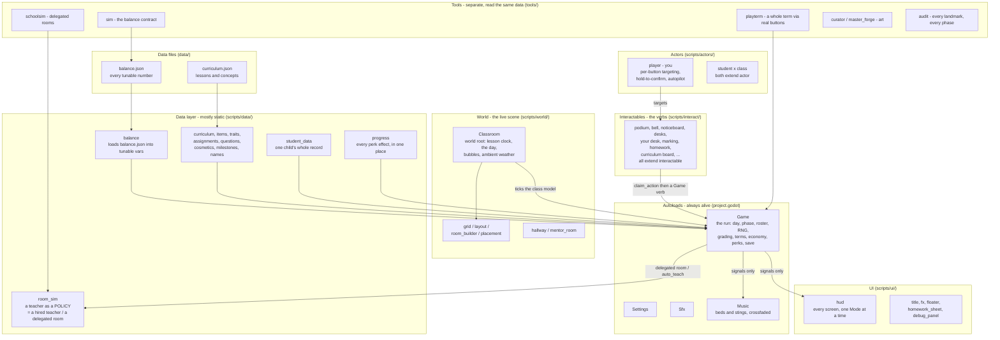
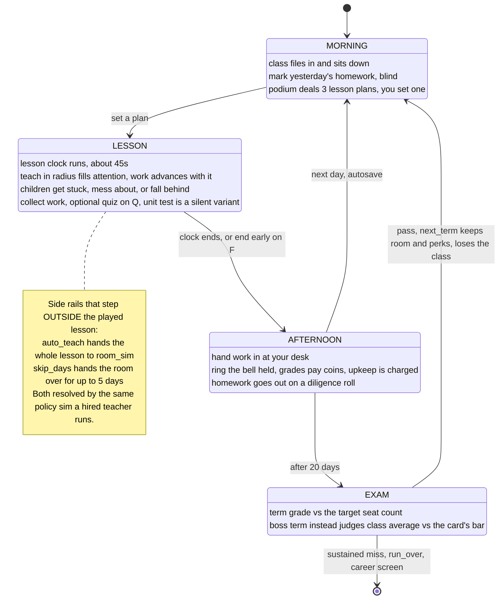
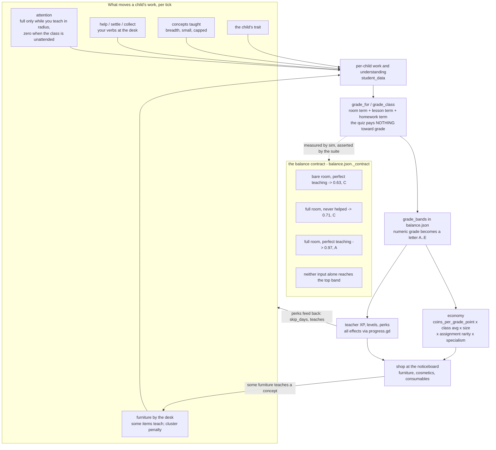
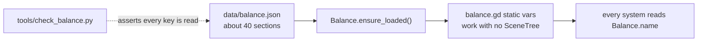
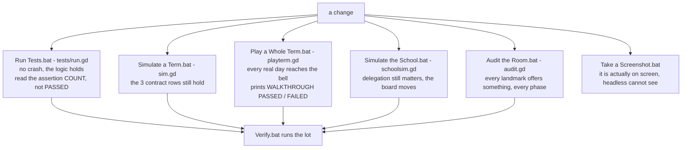

# EDUSystem — architecture map

A picture of how the pieces fit, for orienting before you dive into a file.
It is deliberately **stable**: it names modules and files, not counts or
tuning. A new sprite, a changed number, a bug fix never touch this document.
Revise it only when a whole system is **added or removed**.

- **What the game is**, in prose: [`docs/GDD.md`](GDD.md). If this file and
  the GDD disagree, the GDD wins. If the GDD and the running game disagree,
  the game wins.
- **The file-by-file map** with one-line jobs: the table in
  [`CLAUDE.md`](../CLAUDE.md) / [`AGENTS.md`](../AGENTS.md).
- The diagrams are Mermaid. GitHub renders them in place; VS Code renders
  them in Markdown preview.

---

## 1. Module map — who owns what, who talks to whom

**The one rule that keeps this untangled:** `Game` never reaches into the
HUD or Music. It emits signals (`phase_changed`, `day_changed`,
`coins_changed`, `roster_changed`, `run_started`); they listen. A landmark
never mutates run state directly either — it calls `Game.claim_action()` to
win the keypress, then a named `Game` verb.

---

## 2. The day — a three-phase state machine

Every verb in the game is gated on `Game.Phase`. That single rule is what
keeps the day coherent.

See GDD §4 (the core loop) and §9 (failure).

---

## 3. The grade pipeline — behaviour in, coins and cosmetics out

The loop most worth having a picture of: how a child's day at a desk becomes
a letter, money, and eventually new furniture.

**Why it is shaped this way:** the quiz pays no grade, and assignment rarity
pays coins and XP but never grade, so nothing can move the contract *by luck
rather than by play*. See GDD §2 (the balance contract) and §10 (economy).

---

## 4. Where the numbers live

No tunable number is a `const` in a `.gd` file. There is one table.

The `_contract` and `grade_bands` sections of `balance.json` are load-bearing
design, not ordinary tuning — GDD §2 says why, and the tests assert the band
logic against `Balance.grade_band_*` rather than pinned literals.

---

## 5. How a change gets verified — the golden rule as a picture

> Verify by looking at the running game, not by reading the code.

Only the suite and the walkthrough have a machine-readable pass/fail. The
rest speak prose; read their output.

---

## Keeping this document honest

- It is at the altitude of **modules and rules**, which barely moves. Do not
  pull it down to function level — that is what the code and the GDD are for.
- Update it when a system is **added or removed** (a new autoload, a new
  data module, a phase, the school layer's Phase 2), not on tuning or art.
- The counts and measured numbers live in `docs/GDD.md`, which carries a
  "measured on" date. This file carries none, on purpose.
