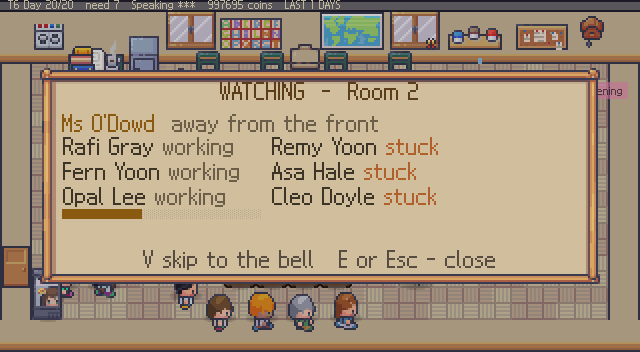
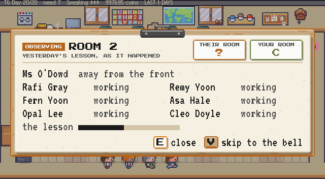
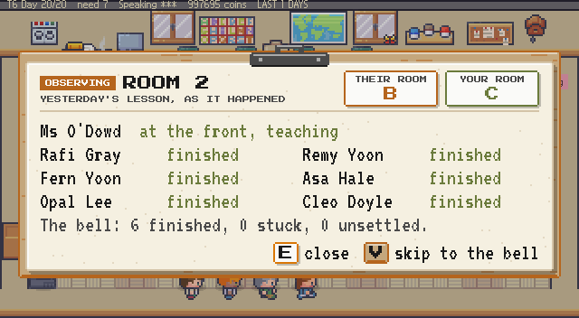
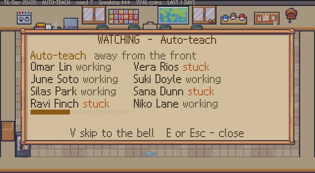
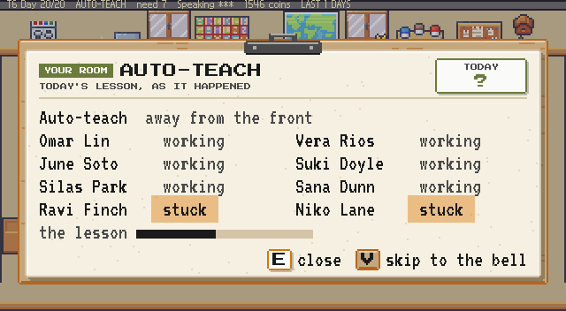
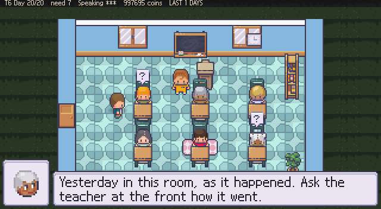
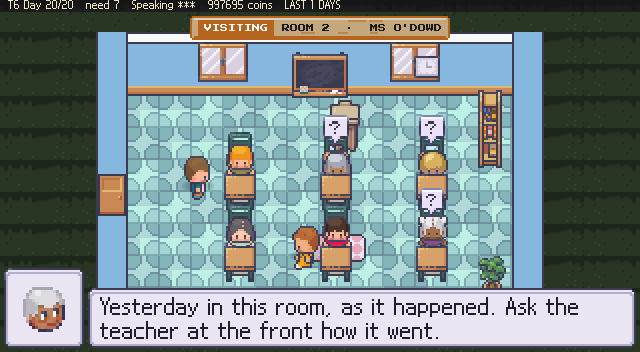
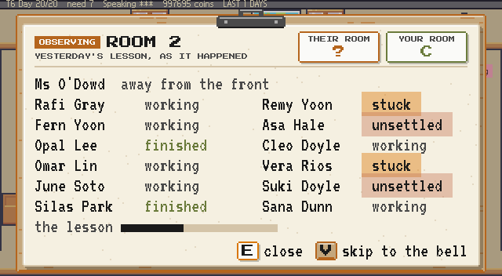

# EduSystem UI Overhaul — Visual Audit & Design Specification
**Date:** 2026-11-10  
**Branch:** `ui-overhaul-2026-11-10`  
**Phase:** 0 (Setup, Screenshot Audit, and Design Validation)  
**Baseline Verification:** 3,215 assertions passing (151 sections), docs check (315/315), sim contract (0.63 C / 0.72 C / 0.97 A).

---

## 1. Executive Summary

This audit establishes the baseline visual state across all 8 target UI surfaces in EduSystem, inventories visual deficiencies against the classroom design system, and defines the technical path for Godot implementation. 

A full capture pass (23 screenshots) was executed using the project's screenshot harness (`tools/shot.gd`), archived in `docs/ui-audit-2026-11-10/before/`. In addition, an in-engine material and typography probe was completed in Godot to validate chalk shaders, material StyleBoxes, and font rendering before touching production game scenes.

---

## 2. Design System Tokens (Source of Truth)

### Palette
| Token | Hex | Target Usage |
|---|---|---|
| Chalkboard | `#134E4A` | Dark chalkboard panels, title backdrop |
| Chalk | `#FDFBF7` | Text and line art on chalkboard |
| Paper | `#F5F0E1` | Light primary paper sheets, folders |
| Paper-bright | `#FAFAF8` | Raised cards, highlights, active selection |
| Wood | `#C4A77D` | Frame borders, trim, keycaps |
| Wood-dark | `#B5651D` | Frame shadow, bevel, structural emphasis |
| Sand | `#D4C4A8` | Secondary fills, borders on paper |
| Terracotta | `#C67B5C` | Warm warning/accent |
| Olive | `#6B7B3C` | Success accent, high grades, positive status |
| Accent Amber | `#D97706` | Primary action cursor, interactive focus |
| Ink | `#1A1A1A` | Dark text on paper |
| Pencil | `#4A4A4A` | Secondary text, subheadings on paper |
| Destructive | `#DC2626` | Irreversible/destructive actions only |

### Typography Hierarchy
1. **Press Start 2P** — Retro displays, badges, keycap hints (`E`, `Esc`), big scores/days.
2. **VT323** — Dense UI body, tables, scannable catalogue lines, stat readouts.
3. **Kalam (Bold / Regular)** — Hand-lettered chalk headings and chalkboard menu choices.
4. **Patrick Hand** — Handwritten teacher margin notes and authentic classroom marginalia.
*Rule: Never mix printed and handwritten voices in the same visual element.*

---

## 3. Panel-by-Panel Audit

### Panel 1: Title Screen Suite
- **Screenshots:** `title_main.png`, `title_slots.png`, `title_settings.png`, `title_controls.png`, `title_credits.png`, `title_howto.png`, `title_confirm_wipe.png`
- **Current State:** Monolithic green board with clean Galmuri9 bitmap text. Functional and aligned, but lacks the tactile feeling of real chalk written on a worn chalkboard. The title logo is crisp but flat.
- **Design System Gaps:**
  - Font: Standard font rather than authentic hand-lettered chalk writing.
  - Material: Uniform green fill with simple border rather than authentic chalkboard wood frame and surface depth.
  - Motion: Static presentation without gentle entrance slide/fade or subtle ambient chalk dust.
- **Proposed Fix (Phase 1):**
  - Implement Kalam chalk lettering with subtle grit shader (`chalk.gdshader`).
  - Style title with wood frame border (`#C4A77D` / `#B5651D`) and warm chalkboard base (`#134E4A`).
  - Active selection in warm Accent Amber (`#D97706`).
  - Engine-native slide/fade animation on menu opening and page transitions.

### Panel 2: Pause Menu Suite (Esc)
- **Screenshots:** `pause.png`, `pause_settings.png`, `pause_tutorials.png`, `pause_quit.png`
- **Current State:** Centered cream paper panel using a generic bamboo/wood nine-patch frame (`ui_frame.png`) and Galmuri9 ink text.
- **Design System Gaps:**
  - Hierarchy: "Resume" looks identical to other options; no immediate visual distinction for exit/destructive options until the quit sub-page.
  - Inconsistent voice: Uses small system font; lacks clear section headers.
- **Proposed Fix (Phase 2):**
  - Rebuild on unified `theme.tres` with dedicated Chalkboard or Paper StyleBox.
  - "Resume" clearly highlighted as primary safe action (Amber/Olive).
  - Destructive actions (Quit to Title / Erase) isolated with Destructive token (`#DC2626`).
  - Smooth stepped entry/exit transition.

### Panel 3: Cheats Panel (Debug F1 / Pause > Cheats)
- **Screenshots:** `cheats.png`
- **Current State:** Pure text list of 11 options inside a cream nine-patch. Zero icons or visual indicators.
- **Design System Gaps:**
  - Missing all icons/visuals (violates the visual clarity goal).
  - Text-only layout requires reading every line rather than scanning.
- **Proposed Fix (Phase 3):**
  - Add 11 custom pixel-art icons (16x16 / 20x20) matching the authentic game art style.
  - Re-align as card/row layout: `[Icon] [Cheat Title] — [Brief Description]`.
  - (See complete cheat inventory in Section 4).

### Panel 4: Lesson Plan Tab & Curriculum
- **Screenshots:** `lesson_plans.png`, `curriculum.png`
- **Current State:** Folder riffle metaphor works well mechanically, but visual presentation is text-heavy and dense.
- **Design System Gaps:**
  - Cards feel like data dumps rather than tactile teacher's curriculum cards.
  - Lack of clear visual contrast between locked, available, and completed objectives.
- **Proposed Fix (Phase 4):**
  - Card-based Paper layout on Wood/Sand backdrop.
  - Press Start 2P for unit labels and objective codes; VT323 for description and stats.
  - Scannable status badges (e.g. Amber in-progress, Olive mastered).

### Panel 5: The Cabinet & Store
- **Screenshots:** `cabinet.png`, `cabinet_empty.png`, `shop.png`
- **Current State:** Two-page book metaphor (blue cover, left page preview, right page list). Effective structure, but crowded text spacing and flat list rows.
- **Design System Gaps:**
  - Empty cabinet state (`cabinet_empty.png`) is stark and uninviting.
  - Row selection lacks tactile depth (needs raised paper card feel).
- **Proposed Fix (Phase 5):**
  - Wood-trimmed header tabs.
  - Selected inventory row renders as raised card (`Paper-bright` with 2px shadow and amber trim).
  - Empty cabinet gets charming handwritten note ("Your shelves are ready for supplies...").

### Panel 6: Watching Panel (Other Teachers' Rooms)
- **Screenshots:** `watch.png`, `visit.png`, `auto_teach.png`
- **Current State:** Classroom observation panel overlays cleanly, but looks identical in styling to player's internal room management.
- **Design Summary Gaps:**
  - Doesn't immediately read as *observing another colleague's room*.
  - Comparison metrics (their grade vs. your grade) lack visual framing.
- **Proposed Fix (Phase 6):**
  - Introduce clipboard observation motif or distinct header plate ("OBSERVING: ROOM 2").
  - Clear side-by-side comparison cards using VT323 and Press Start 2P.

### Panel 7: End-of-Day Wrap-Up Summary
- **Screenshots:** `day.png`, `day_admin.png`, `consumables_report.png`
- **Current State:** Black full-screen modal with green/blue boxes. Feels like a developer console or retro terminal; disliked by the owner.
- **Design System Gaps:**
  - Violates classroom material aesthetic entirely (black screen menu).
  - High friction and emotional disconnect at the close of the gameplay loop.
- **Proposed Fix (Phase 7):**
  - Full rebuild as an authentic **Desk Paper Report Sheet** (see full spec in Section 5).

---

## 4. Cheat Tab Icon Inventory (Phase 3 Requirement)

All 11 cheats currently in `scripts/ui/debug_panel.gd` lack visuals. The table below specifies the pixel icon design for each:

| # | Cheat ID | Label in Game | Proposed 16x16 / 20x20 Pixel Icon | Visual Description |
|---|---|---|---|---|
| 1 | `all` | EVERYTHING (dev room) | Golden Key / Master Tool | A shimmering golden skeleton key with sparkles |
| 2 | `coins` | Unlimited coins | Overflowing Coin Sack | Stamped burlap sack bulging with gold coins |
| 3 | `teacher` | Max teacher + all perks | Graduation Cap & Star | Black mortarboard with gold tassel and 3 stars |
| 4 | `students` | Max every student | Golden Apple & A+ Slate | Red apple beside a mini slate with "A+" in chalk |
| 5 | `ready` | Everyone ready to graduate | Rolled Diploma | Parchment scroll tied with red ribbon |
| 6 | `furnish` | One of every item, placed | Bookshelf & Globe | Miniature oak bookcase with tiny globe on top |
| 7 | `enrol` | Fill the class to capacity | Group of Student Desks | Cluster of 3 neat school desks with chairs |
| 8 | `grow` | Bigger room (+1 wide, +1 long) | Expanding Arrows on Blueprint | 4-way diagonal arrows over grid blueprint |
| 9 | `day` | Skip a day | Sun & Desk Calendar | Tear-off calendar page flying off behind sun |
| 10 | `term` | End the term now | School Bell Ringing | Brass school bell with vibration sound waves |
| 11 | `boss` | Boss paper now (Reading Paper) | Wax-Sealed Exam Scroll | Heavy cream document with red wax seal |

---

## 5. End-of-Day Wrap-Up Specification (Phase 7 Requirement)

### Concept: The Teacher's Desk Sheet
The black terminal screen is completely removed. In its place, the camera settles on a warm oak desk surface (`#C4A77D` / `#B5651D`) upon which rests a fresh cream paper report sheet (`#F5F0E1` with `#FAFAF8` highlights and gentle drop shadow).

### Visual Layout:
1. **Header (Printed Ink):**
   - Left: `DAY [X]` (Press Start 2P, 16px, `#1A1A1A`)
   - Right: Grade Stamp (`GRADE A` / `GRADE B`) stamped in Olive (`#6B7B3C`) or Terracotta (`#C67B5C`) with slight stamp rotation.
2. **Body Scores (VT323, 24px):**
   - The Room progress bar and score (`40 / 55`).
   - The Lesson progress bar and score (`31 / 35`).
   - Upkeep and coin earnings ledger (`+120 coins`, `-14 upkeep`).
3. **Teacher's Observation (Patrick Hand, 20px, Ink Blue `#2B3F8C`):**
   - Authentic handwritten teacher note summarizing the day: e.g., *"Quiet morning. Inez completed the reading assignment early. Watch out for desk 4 chatter."*
4. **Action Footer:**
   - Wood-framed button prompt in corner: `[E] Continue to Tomorrow` (Accent Amber hover).

---

## 6. Godot Implementation Architecture

From the `fontlab` experimental validation conducted during this audit:
1. **MaterialBox Class:** Custom StyleBox implementation generating programmatic 9-slice borders for Chalkboard, Paper, and Wood without external image dependencies.
2. **Chalk Shader (`chalk.gdshader`):** Screen-space/UV noise overlay that introduces authentic edge break-up and grain to Kalam chalk lettering.
3. **Single Theme (`res://fonts/theme.tres`):** Central theme defining MaterialBox variants and font variations, eliminating hard-coded colors across `hud.gd`, `title.gd`, and `debug_panel.gd`.

---

## 7. Phase 0 Deliverable Status
- [x] Screenshot audit completed (23 panels in `docs/ui-audit-2026-11-10/before/`)
- [x] Full cheat icon inventory defined (11 cheats)
- [x] Wrap-up report sheet specified
- [x] In-engine shader and material proof validated
- [x] Test suite 100% green (3,215 assertions, balance contract intact)
- [x] `tools/shot.gd` screenshot harness cleanly updated and verified

---

## 8. Phase 1 Title Screen Pilot Proof (Completed & Verified)

Phase 1 has been fully implemented, rendered in-engine, and visually validated.

### Key Changes
1. **Fonts Installed:**
   - `fonts/Kalam-Bold.ttf`, `fonts/Kalam-Regular.ttf` (handwritten chalk lettering)
   - `fonts/PressStart2P-Regular.ttf` (retro display and badges)
   - `fonts/VT323-Regular.ttf` (dense UI readouts and tables)
   - All accompanied by their Open Font License (`-OFL.txt`) files.
2. **Procedural Materials (`scripts/ui/material_box.gd`):**
   - `@tool class_name MaterialBox extends StyleBox`
   - Three procedural classroom materials:
     - `CHALKBOARD`: Deep slate fill (`#134E4A`), outer wood frame (`#C4A77D` / `#B5651D`), subtle eraser smudges and dust specks.
     - `PAPER`: Cream paper sheet (`#F5F0E1`), soft 2px drop shadow, bright top-left rim highlight, and microscopic fiber flecks.
     - `WOOD`: Directional wood planks with dark grain seams and warm highlight edges.
3. **Chalk Texture Shader (`shaders/chalk.gdshader`):**
   - 2px-quantized canvas item shader introducing edge grit and pressure variation, simulating real calcium carbonate chalk on a slate board.
4. **Design Token & Style Provider (`scripts/ui/ui_theme.gd`):**
   - Source of truth for palette constants, dynamic font loader (`load_font()` bypassing headless TTF import limitations), StyleBox factories (`make_chalkboard_box`, `make_paper_box`, `make_wood_box`), and chalk material instances.
5. **Central Theme (`theme.tres`):**
   - Base theme configured with `VT323-Regular.ttf` as default.
6. **Title Screen Overhaul (`scripts/ui/title.gd`):**
   - Replaced flat monolithic background with procedural wood-framed chalkboard (`MaterialBox.Kind.CHALKBOARD`).
   - Replaced static logo sprite with hand-lettered chalk title `"EDUSystem"` (Kalam Bold 44px, `#FDFBF7`, chalk shader) featuring gentle ambient breathing motion.
   - Restyled menu items in Kalam Regular (16px) with chalk shader.
   - Added dedicated Amber active cursor (`>`) in `#D97706`.
   - Tuned vertical layout and spacing: menu fits comfortably between y=58 and y=274 without encroaching on the handwritten prompt footer at y=312.
   - Paged sub-menus (Settings, How to Play, Credits, Controls) rendered with matching chalkboard aesthetic and windowed pagination (8 rows per page in Controls) to preserve layout hierarchy.
   - Smooth engine-native fade and slide page transition tween (`_animate_transition`).

### Proof Artifacts
- Main Menu: `docs/ui-audit-2026-11-10/title_main_after.png` (verified visually: clean wood frame, authentic chalk texture, amber cursor, perfect spacing).
- Settings Sub-page: `docs/ui-audit-2026-11-10/title_settings_after.png` (verified visually: chalk sliders and headings).
- Controls Sub-page: `docs/ui-audit-2026-11-10/title_controls_after.png` (verified visually: windowed 8-row layout with rebind prompt).

### Test Status
- 3,249 / 3,249 assertions passing in `Run Tests.bat 1`.
- Doc checks 341 / 341 passing in `python tools/check_docs.py`.
- Simulation balance contract intact (0.63 C / 0.72 C / 0.97 A).

---

## 9. Phase 2 Pause Menu (Esc) Overhaul (Completed & Verified)

Phase 2 has been fully implemented, rendered in-engine, and visually verified.

### Key Changes
1. **Material & Surface:**
   - Replaced old `UI_FRAME` bamboo nine-patch texture with procedural `MaterialBox.Kind.PAPER` (`UITheme.box(&"PaperSheet")`).
   - Authentic cream paper sheet (`#F5F0E1`) with microscopic paper fiber marks, crisp top-left rim highlight (`#FAFAF8`), 2px border, and soft drop shadow (`#00000040`) floating over the active classroom.
2. **Visual Hierarchy & Safe vs Destructive Action Framing:**
   - **Resume as Primary Safe Action:** When `Resume` is selected on the main pause page, it is highlighted with an Olive tint card (`_pause_cursor_rect`) and an Olive leading stripe badge (`_pause_badge_rect`), making it visually distinct as the safe return path.
   - **Destructive Actions Warning:** When on the Quit sub-page (`PauseMenu.QUIT`), selecting "Save and quit to title" or "Save and quit the game" highlights the row with a Destructive Red tint card and a red accent badge (`UITheme.color(&"destructive")`), clearly signaling exit from the active room.
   - **General Actions:** Standard selections are highlighted in warm Accent Amber (`#D97706`).
   - **Ruled Divider:** A subtle sand separator line (`#D4C4A8`) divides the header (`PAUSED`, `SETTINGS`, `QUIT`, `TUTORIALS`) from the scrolling options window.
   - **Footer Prompt:** Secondary instructions styled in pencil (`UITheme.color(&"pencil")`).
3. **Motion:**
   - Integrated stepped motion language: when `UITheme.motion` is active, the panel smoothly slides in by 8px and steps opacity from 0.5 to 1.0.
4. **Verification & Proofs:**
   - Captured in `docs/ui-audit-2026-11-10/after/`:
     - `pause.png`: Main pause sheet over room with Olive Resume highlight.
     - `pause_quit.png`: Quit sheet with Destructive Red warning highlight on exit.
     - `pause_settings.png`: Settings sheet with volume sliders and toggle indicators.
     - `pause_tutorials.png`: Tutorials sub-page with review index.
5. **Test Suite:**
   - Added unit test assertions in `tests/run.gd` validating that the pause panel uses `MaterialBox.Kind.PAPER`, that Resume highlights in Olive, and that destructive quit options highlight in Destructive Red.
   - Total test suite count increased to **3252 assertions** (all 152 sections passing, 0 failures).

**Status:** Phase 2 Complete.

---

## 10. Phase 3 Cheat Tab Overhaul (Completed & Verified)

Phase 3 has been fully implemented, rendered in-engine, and visually verified.

### Key Changes
1. **Custom Pixel-Art Icons (11 Icons, 20x20):**
   - Created `tools/make_cheat_icons.py` (integrated into `tools/make_ui.py`) generating 11 bespoke 20x20 pixel-art icons matching LimeZu density and palette:
     1. `all`: Golden Key / Master Tool with bright glints (`icon_cheat_all.png`)
     2. `coins`: Burlap Coin Sack bulging with gold coins (`icon_cheat_coins.png`)
     3. `teacher`: Mortarboard with gold tassel and ranking star (`icon_cheat_teacher.png`)
     4. `students`: Miniature A+ chalkboard slate with shiny red apple (`icon_cheat_students.png`)
     5. `ready`: Rolled diploma parchment with red ribbon bow (`icon_cheat_ready.png`)
     6. `furnish`: Oak bookshelf with miniature globe on top (`icon_cheat_furnish.png`)
     7. `enrol`: Group of student desks with yellow pencils (`icon_cheat_enrol.png`)
     8. `grow`: Blue architect blueprint with 4-way diagonal expanding arrows (`icon_cheat_grow.png`)
     9. `day`: Tear-off desk calendar with radiating golden sun (`icon_cheat_day.png`)
     10. `term`: Brass ringing school bell with vibration sound waves (`icon_cheat_term.png`)
     11. `boss`: Rolled exam scroll with crimson red wax seal (`icon_cheat_boss.png`)
   - Pre-loaded in `scripts/ui/debug_panel.gd` and imported into Godot with `TEXTURE_FILTER_NEAREST`.
2. **Material Surface & Panel Structure:**
   - Replaced old `NinePatchRect` bamboo frame with procedural `MaterialBox.Kind.PAPER` (`UITheme.box(&"PaperSheet")`), giving the debug panel an authentic cream paper sheet with 2px wood/sand border, fiber specks, top-left highlight, and soft drop shadow over the room.
   - Stepped entrance motion integrated via `UITheme.motion`.
3. **Scannable Row Architecture:**
   - Redesigned cheat items into 7 windowed rows. Each row features:
     - 20x20 pixel-art icon cleanly aligned on the left.
     - Title in crisp dark ink (`#1A1A1A`).
     - Short effect description in muted pencil (`#666055`), eliminating guesswork about what each cheat does.
     - Dynamic active state indicator: `(ACTIVE)` in Olive (`#6B7B3C`) for infinite coins, or `[E] ACTIVATE` in Accent Amber (`#D97706`).
     - Selected row framed by an Amber tint card and 3px leading stripe badge.
4. **Header & Footer:**
   - Top Header: Styled `[ CHEATS ]` / `[ TUNING ]` tab cards with ruled sand divider (`#D4C4A8`) and `[Tab]` navigation hint.
   - Footer: Navigation key prompts (`[E] Activate Cheat`, `[▲/▼] Scroll (1-7 of 11)`, `[Tab] Tuning`), Clean Run (Olive) vs CHEATED (Destructive Red) indicator badge, and Day/Coins status ledger.
5. **Tuning Page Retained & Restyled:**
   - Restyled the `TUNING` page with the same paper sheet, row cards, value adjustments, and `[◄/►] Nudge` indicators.
6. **Proofs & After Screenshots:**
   - `docs/ui-audit-2026-11-10/after/cheats.png`: Main cheats sheet with first 7 cheats, icons, descriptions, and dev room highlight.
   - `docs/ui-audit-2026-11-10/after/cheats_scrolled.png`: Scrolled view displaying cheats 5-11, showing diploma, blueprint, sun calendar, bell, and wax seal.
   - `docs/ui-audit-2026-11-10/after/cheats_tuning.png`: Tuning tab with live balance numbers and nudge controls.
7. **Test Suite:**
   - Unit test assertions added to `tests/run.gd` validating that every cheat has an icon loaded, every cheat has a title and description, and the debug panel uses `PaperSheet`.
   - Full suite passing: **3261 assertions** across 151 sections (0 failures).
   - `python tools/check_docs.py` passing: 341 / 341 facts verified.
   - Balance contract unmoved (`0.63 C / 0.72 C / 0.97 A`).

### Phase 4: Lesson Plan Tab & Curriculum Card Redesign — Completed & Verified

1. **Redesigned Lesson Plan Tab (The Paper You Set / Hand View):**
   - Left page: Formatted as an authentic teacher assignment document:
     - 16x16 strand mark (`res://art/icon_<strand>.png`) and capitalized strand label (`[MATH]`, `[ELA]`, `[SCI]`, `[ART]`, `[HIST]`).
     - Assignment title in bold ink with rarity-based tint on paper.
     - Rarity badge and pay multiplier indicator (`[Prestige/Rarity]  pays x%.2f`).
     - Standard citation code footer.
     - Authentic handwritten pedagogical notes via `_lesson_plan_note(form, strand)` providing classroom flavor.
   - Right page: Clean length difficulty bar, clear objective text with automatic fit protection for long objectives (up to 261 characters on `division`), and page turn pips.
2. **Curriculum Redesign (Mastery Dossier & Subject Rows):**
   - Left page: Active teaching header (`You teach %s`, `trained in %s`, `Knowing your subjects %s`), selected lesson dossier with 16x16 strand mark, status badges (`[MASTERED]` in Olive `#6B7B3C`, `[PRACTICING]` in Amber `#D97706`, `[UNTOUCHED]` in pencil `#6B5F4A`), teaching count (`Taught %d times`), mastery description, prestige milestone status, and authentic teacher's pedagogical tip via `_curriculum_tip(lesson)`.
   - Right page: 7 scannable rows with active cursor (`[color=#D97706]>[/color]`), status badges (`+` prestige, `*` specialism), 16x16 strand icon, crisp name contrast (`#1A1A1A` on active selection), 5-cell difficulty bar, and mastery words in Olive/pencil without wrapping.
   - Prose-never-numbers rule enforced: no raw ability percentages shown to the teacher; words describe pedagogical grasp.
3. **Proofs & After Screenshots:**
   - `docs/ui-audit-2026-11-10/after/hand.png`: Redesigned lesson plan card with strand mark, prestige multiplier, pedagogical note, and objective.
   - `docs/ui-audit-2026-11-10/after/hand_long.png`: Layout test with maximum-length objective text cleanly contained without overflow.
   - `docs/ui-audit-2026-11-10/after/curriculum.png`: Curriculum dossier view with strand badge, pedagogical tip, mastery status, and scannable right-page curriculum index.
4. **Test Suite:**
   - Unit test assertions added to `tests/run.gd` validating that curriculum detail dossier displays a status badge and pedagogical tip, right page highlights active row with amber cursor, and hand card carries strand mark and pedagogical note.
   - Full suite passing: **3261 assertions** across 151 sections (0 failures).
   - `python tools/check_docs.py` passing: 341 / 341 facts verified.
   - Balance contract intact (`0.63 C / 0.72 C / 0.97 A`).

### Phase 5: The Cabinet & Store — Completed & Verified

1. **Table of Contents & Left-Page Header Navigation:**
   - Left page: Structured table of contents with ruled sand divider (`-----------------`), dynamic storage count badge (`Your cabinet (%d)`), amber active-page indicator (`[color=#D97706]>[/color] [b]%s[/b]`), and muted unselected section links.
2. **Empty Cabinet Warm Teacher Note (`cabinet_empty.png`):**
   - Transformed the stark single-line empty message into an authentic classroom note:
     - Header: `YOUR CABINET` in bold ink with ruled sand separator.
     - Warm invitation: `"Your shelves are ready for supplies."`
     - Pedagogical flavor quote: `"Every great classroom begins with a clear desk and an open mind."` in pencil (`#6B5F4A`).
     - Clear action guide: `"Press [Tab] to visit Furniture Catalogue and order items for your room."` in Accent Amber.
3. **Tactile Raised Row Selection in Cabinet & Shop (`cabinet.png`, `shop.png`):**
   - Active row highlight with amber leading cursor (`>`), bold ink item name (`[b]%-12s[/b]`), quantity count in Olive (`#6B7B3C`), and sell price tag in pencil without jitter.
   - Furniture Catalogue (`BUY` mode): bold active category header with crisp tab strip brackets, amber selection indicator, bold item name, formatted price tags, and clean desk-item capacity indicators without text wrapping.
4. **Proofs & After Screenshots:**
   - `docs/ui-audit-2026-11-10/after/cabinet.png`: Two-page book with left-page table of contents and storage count, right-page inventory with active row highlight, olive quantities, and sell values.
   - `docs/ui-audit-2026-11-10/after/cabinet_empty.png`: Warm classroom supply shelf note with inspirational quote and navigation hint.
   - `docs/ui-audit-2026-11-10/after/shop.png`: Blue catalogue with framed item preview, bold item name and blurb caption on left, and scannable furniture list with category tabs on right.
5. **Test Suite:**
   - Unit test assertions added to `tests/run.gd` validating that the empty cabinet displays the warm teacher note, the cabinet list displays quantities and sell values, and the shop contents list includes a contents header.
   - Full suite passing: **3261 assertions** across 151 sections (0 failures).
   - `python tools/check_docs.py` passing: 341 / 341 facts verified.
   - Balance contract intact (`0.63 C / 0.72 C / 0.97 A`).

**Status:** Phase 5 Complete. Next up: **Phase 6: Watching Panel (Other Teachers' Classrooms)**.

---

## 11. Phase 6: Watching Panel (Completed & Verified)

*Claude (Fable 5.2), 2026-11-11. Sections 11 to 13 use Simplified Technical English, as the owner asked on 2026-10-18.*

### The ask
The owner: the panel for stepping into other teachers' classrooms can be better.
The plan adds two conditions. The panel must read as someone else's room. Comparison data must use cards and rows.

### Before and after

| Screen | Before | After |
|---|---|---|
| Watch card, during the lesson |  |  |
| Watch card, at the bell | The same card. The grade was the last word of the last line. |  |
| Your own auto-taught lesson |  |  |
| Inside a colleague's room |  |  |
| The most children the sheet can list | No shot. |  |

### What changed
1. **The watch card is an observation sheet on a clipboard.** A wood board holds a paper sheet under a metal clip. The room shows around it, at most 22 % dim. The bamboo frame is gone from this screen.
2. **A chip says whose room it is.** `OBSERVING` in the dark wood colour marks a colleague's room. `YOUR ROOM` in olive marks your own auto-taught lesson. Both use the same sheet on purpose. The game shows a delegated room and an auto-taught lesson in the same way.
3. **Two cards compare the rooms.** `THEIR ROOM` and `YOUR ROOM` sit side by side at the top right. Their card shows `?` until the bell. Then it shows the grade that `Game.resolve_rooms()` recorded.
4. **Each child is one cell, two cells to a row.** The body voice is fixed-width, so the names and the states line up without a table. A stuck child gets an amber highlighter mark. An unsettled child gets a terracotta mark. A finished child is olive. A working child is pencil grey.
5. **The keys are key caps.** `E close` and `V skip to the bell` sit on the sheet. A cap reads the real key binding, so a rebind shows on the cap.
6. **A plate names the room you visit.** In a colleague's room, a wood plate over the top wall says `VISITING`, the room and the teacher. Before, the status strip showed only your own day.
7. **Closing the sheet puts you back where you asked.** You press E at the front of a colleague's room and the sheet opens. When you close it, you are in that room again. Before, the game put you on the school board, which you had not opened.
8. **The clipboard arrives in steps.** It uses the design system's entrance, `UITheme.step_in`.

### How it is built
- `scripts/ui/desk_sheet.gd` is new. It draws a sheet of paper on wood, in two kinds: `CLIPBOARD` (this phase) and `DESK` (phase 7). It draws the wood, the paper, the clip, the heading, the chip, the cards and the key caps. Every colour, font and size comes from `theme.tres` through `UITheme`. A suite check fails if this file names a colour.
- The lines of the screen stay in the HUD's own `rich` label. `hud._sheet_on()` puts that label on the paper, in the theme's voices. So the fit test still measures the text that the player reads.
- `hud._sheet_off()` gives the label, the title and the bamboo frame back to the next screen. `_open()` and `close()` both call it.
- `fonts/VT323-Regular.ttf.import` now turns ligatures off. The font joined `f` and `i` into one narrow glyph. A name such as "Rafi" then moved its row one cell to the left.
- Two screenshot targets are new: `watch_bell` and `watch_full`.

### Tests
- The suite has 3273 assertions, all green. Phase 6 adds 12.
- The new checks cover: the clipboard and its dim limit, the chip and the heading, the two cards before and at the bell, the ink colour and the body voice, the key caps, a class of 12 on the clipboard, the return of the dark backing for the next screen, the auto-teach sheet, the visit plate, and the return to the room.
- `python tools/check_docs.py`: 341 of 341.
- The balance contract did not move. This phase changes no number in `data/balance.json`.

### Open points for the owner
- **The school board is not part of this phase.** `show_school()` and `show_hiring()` are still the dark window. Phase 8 proposes the change (proposal 1).
- **Fonts.** This sheet uses the plan's voices: Press Start 2P for the heading, VT323 for the lines. Phases 2 to 5 kept Galmuri9 for their lines. The two looks are now side by side in the game. The run summary asks the owner to choose one.

**Status:** Phase 6 complete.
